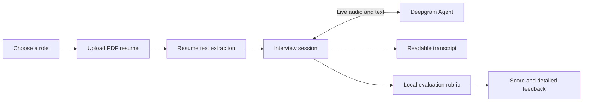

<div align="center">

# AI Interviewer

### A focused, voice-first technical screening experience

Candidates choose a role, upload a resume, complete a two-minute AI-led interview, and receive a structured performance review.

[](https://interviewer.aayushmistri.space)
[](https://react.dev/)
[](https://nodejs.org/)
[](https://developer.mozilla.org/en-US/docs/Web/API/WebSockets_API)

<br />

| Select a role | Upload a resume | Speak with the interviewer | Review your score |
|:---:|:---:|:---:|:---:|
| `01` | `02` | `03` | `04` |

</div>

> [!NOTE]
> The live demo is available at [interviewer.aayushmistri.space](https://interviewer.aayushmistri.space). Since it depends on resume parsing, microphone permissions, a remote voice-agent connection, and post-interview evaluation, users may experience delays while starting an interview or waiting for the final result.

<details>
<summary><strong>What makes it different?</strong></summary>

AI Interviewer is built around a short, high-signal screening loop rather than a general chatbot conversation. The interview prompt uses the candidate's selected role and resume context, while the evaluation looks for answer depth, technical reasoning, relevance, and concrete evidence.

</details>

The application is designed as a local full-stack project:

- React and Vite provide the candidate-facing experience.
- Node.js and Express manage resume processing, sessions, and evaluation results.
- WebSockets stream microphone audio between the browser and the backend.
- Deepgram Agent API provides speech recognition, interview reasoning, and voice responses.
- Local files store readable conversation histories and spreadsheet exports.

## Features

- Role-based interview selection for AI Engineer, Python Intern, and WebDev Intern roles.
- PDF resume upload and text extraction.
- Candidate name extraction and resume context injection into the interview prompt.
- Real-time voice conversation through the browser microphone.
- Two-minute interview timer with manual and automatic completion.
- Human-readable transcript files created for every interview.
- Detailed evaluation based on:
  - Question coverage
  - Answer depth
  - Technical reasoning
  - Resume relevance
  - Concrete examples and measurable evidence
- Question-by-question feedback with answer quality scores.
- Strengths, weaknesses, and improvement advice.
- Evaluation export to `back/candidate-evaluations.xlsx`.
- Minimal grayscale glassmorphism interface.

## Interview Flow

1. The candidate selects a job role.
2. The candidate uploads a PDF resume.
3. The backend extracts the resume text and creates a temporary interview session.
4. The browser opens a WebSocket connection using the session ID.
5. The backend configures a Deepgram Agent with the candidate name, resume, and selected role.
6. Microphone audio is streamed to the agent and agent audio is played back in the browser.
7. Conversation text is recorded while the interview is in progress.
8. The interview ends when the candidate presses **End Interview** or the two-minute timer expires.
9. The backend calculates the score, saves the transcript, and exposes the result through the evaluation route.
10. The browser redirects to the detailed evaluation page.



## Architecture

```text
AIinterviewer/
├── back/
│   ├── controllers/
│   │   ├── evaluateTra.js       Evaluation API and result lookup
│   │   └── resumeLogic.js       PDF upload and resume session creation
│   ├── sockets/
│   │   └── onConnection.js      Browser-to-Deepgram WebSocket bridge
│   ├── utils/
│   │   ├── conversationHistory.js
│   │   ├── deepgramPrompt.js
│   │   ├── pdfScrap.js
│   │   └── postInterview.js     Transcript parsing and scoring
│   ├── conversationHistory/     Generated readable transcript files
│   ├── server.js
│   └── config.js
├── front/
│   ├── src/
│   │   ├── app.jsx              Routes and UI pages
│   │   └── main.jsx
│   └── package.json
└── README.md
```

## Requirements

- Node.js 18 or newer
- npm
- A Deepgram API key with access to the Agent API
- A browser with microphone access
- A PDF resume containing selectable text

## Installation

Clone the repository and install dependencies for both applications:

```bash
git clone <your-repository-url>
cd AIinterviewer

cd back
npm install

cd ../front
npm install
```

## Configuration

Create `back/.env`:

```env
DEEPGRAM_API_KEY=your_deepgram_api_key
PORT=3001
FRONTEND_ORIGIN=http://localhost:5173
```

The backend uses these defaults when variables are omitted:

| Variable | Default | Description |
| --- | --- | --- |
| `DEEPGRAM_API_KEY` | none | Required Deepgram Agent API key |
| `PORT` | `3001` | Backend HTTP and WebSocket port |
| `FRONTEND_ORIGIN` | `*` | Allowed frontend origin |

The frontend works without an environment file when the backend runs on port `3001`. To use another backend address, create `front/.env`:

```env
VITE_AGENT_WS_URL=ws://localhost:3001
VITE_API_URL=http://localhost:3001
```

`VITE_AGENT_WS_URL` is used for the live interview WebSocket. `VITE_API_URL` is used for resume uploads and evaluation requests.

## Running Locally

Start the backend in one terminal:

```bash
cd back
npm run dev
```

Start the frontend in a second terminal:

```bash
cd front
npm run dev
```

Open the Vite URL, usually:

```text
http://localhost:5173
```

The backend health check is available at:

```text
http://localhost:3001/health
```

## Conversation History

When an interview starts, the backend creates a UTF-8 text file in `back/conversationHistory/`.

Example:

```text
AI Interviewer - Conversation History
Candidate: Jane Doe
Role: AI Engineer
Session ID: 4b2...
Started: 07 Aug 2026, 07:40:12 pm

AI: Tell me about a technical project you built.
[Jane Doe]: I built a Python API for an internal dashboard...
AI: Why did you choose that architecture?
[Jane Doe]: I chose it because...

Interview ended: 07 Aug 2026, 07:42:01 pm
Reason: Interview ended
Score: 78
```

Files are named with the candidate name and session ID to keep each interview separate. The folder is created automatically if it does not exist.

## Evaluation System

The active evaluator is deterministic and runs locally in the backend. It does not depend on a second LLM being installed.

The score is calculated out of 100 using these categories:

| Category | Maximum |
| --- | ---: |
| Question coverage | 30 |
| Answer depth | 25 |
| Technical reasoning | 20 |
| Resume relevance | 15 |
| Concrete evidence | 10 |

Very short interviews are capped automatically. For example, an interview containing only one-word or conversational answers cannot receive a high technical score simply because the candidate completed the session.

The evaluation response includes:

- Overall score and summary
- Category score breakdown
- Number of meaningfully answered questions
- Question-by-question answer review
- Strengths
- Weaknesses
- Improvement advice
- Transcript and duration metadata

## Backend Routes

| Method | Route | Purpose |
| --- | --- | --- |
| `GET` | `/health` | Check backend availability and Deepgram configuration |
| `POST` | `/resume` | Upload a PDF resume and create an interview session |
| `GET` | `/evaluation/:sessionId` | Retrieve a completed evaluation |
| `POST` | `/api/evaluate-local` | Evaluate a supplied transcript through the local evaluation controller |
| `WS` | `ws://localhost:3001?sessionId=<id>` | Start the live voice interview |

The `/resume` endpoint expects a multipart form upload with:

- `resume`: PDF file, maximum 5 MB
- `jobRole`: selected role name

## Development Commands

Frontend production build:

```bash
cd front
npm run build
```

Frontend preview build:

```bash
cd front
npm run preview
```

Backend development server:

```bash
cd back
npm run dev
```

## Data and Privacy Notes

- Active resume sessions and completed evaluations are kept in memory and are lost when the backend restarts.
- Conversation histories are written locally under `back/conversationHistory/`.
- Evaluation exports are written to `back/candidate-evaluations.xlsx`.
- Resume text is sent to the configured Deepgram Agent as interview context.
- Do not commit API keys, private resumes, conversation transcripts, or generated evaluation files to a public repository.

## Troubleshooting

### The backend exits or the interview does not start

Check that `back/.env` contains a valid `DEEPGRAM_API_KEY` and that the Deepgram project has Agent API access.

### The frontend cannot connect to the backend

Confirm that the backend is running on port `3001`, or set matching `VITE_AGENT_WS_URL` and `VITE_API_URL` values in `front/.env`.

### The browser cannot hear the interviewer

Allow microphone access for the frontend origin. Check that the browser is not blocking audio playback and that the Deepgram Agent connection remains open.

### Port 3001 is already in use

Stop the existing Node process or set another `PORT` in `back/.env`. If the port changes, update the frontend environment variables as well.

### Resume upload fails

Only PDF files are accepted, the file must be smaller than 5 MB, and the PDF must contain extractable text rather than only scanned images.

## License

Add the project license here before publishing the repository.
